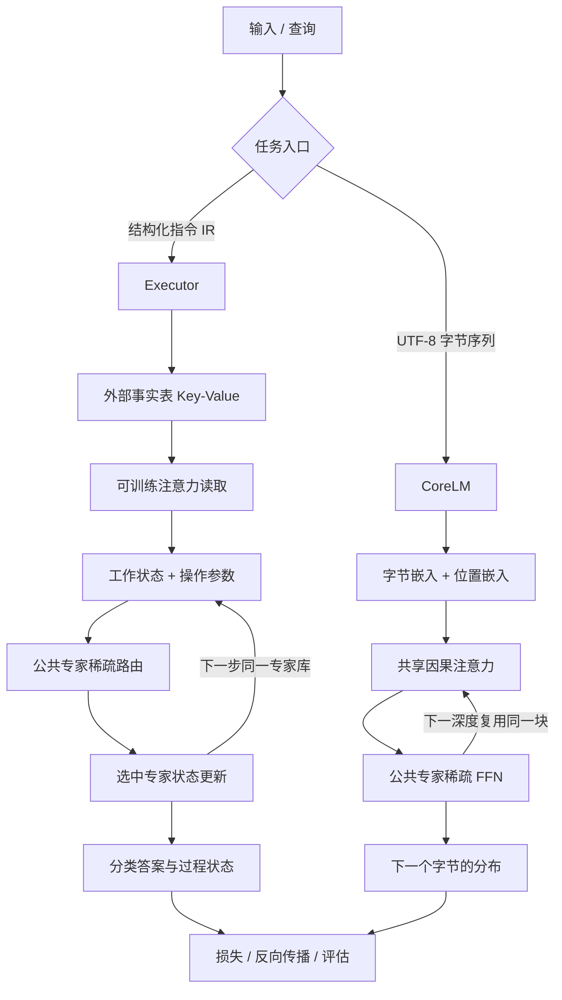

# CoreCPU：组件化递归智能引擎

**架构与可复现实验交接规格 v0.1**

- 状态：已实现可训练、可推理的 PyTorch 研究原型；本地 CPU 实测通过。
- 研究思想来源：313 的前端核心 CPU 认知架构讨论（公共结构抽象、参数化、复用、递归、外部索引、按需计算）。
- 本文用途：直接交给 Codex，从可运行的基础工程出发，逐级验证和改进；不是已经实现的通用超级智能，也不是物理 CPU 电路设计。
- 实现语言：Python + PyTorch。不需要 React、网络 API、商业模型、额外数据集或 GPU 即可完成最小实验。

## 0. 给 Codex 的执行指令（先读）

你的任务是实现并验证 CoreCPU 神经网络研究原型。本文附录 A 已包含完整可运行的 `core_cpu.py`，随文另有源码包；若工作区已有同版本源码，优先复用，不要重新发明一个架构。若只有本文，直接将附录代码提取为相应文件。保持研究目标不变，先做小实验，再扩展。

1. 建立独立工程或分支，检查 Python、PyTorch、CUDA 可用性，记录设备、版本、随机种子。不要改动用户其他研究仓库，也不要在未经确认时将代码上传或发表。
2. 运行 `python core_cpu.py selftest`。如果失败，先修复错误并写明原因，不允许绕过断言。
3. 运行 CPU 最小训练及推理，或者使用已提供的示例权重验证推理。首先保留本文默认结构和数据划分。
4. 按实验矩阵运行 shared、dense（等专家宽度）、dense（近似等总参数）、GRU、无路由标签等对照。先跑种子 313，再跑 101、202、303。不要只报告成功的种子；保留所有原始日志、配置、权重及失败记录。
5. 单独运行语言模型的 shared、shared_dense、dense。先用 `--demo` 验证工程，再使用经过授权的真实文本。语言模型和结构执行器当前是两个独立训练任务，不要把两者的参数直接混为一体。
6. 测试 OOD、新运算组合、长链和外部记忆更改。准确区分可执行的功能与未来设想。不能以训练集准确率、单次实验或同构玩具任务作为通用智能的证据。
7. 首轮结束时输出 `reports/v0.1.md`、`reports/results.csv` 和各轮 JSONL 日志。必须说明失败的路径、参数数、模型大小、激活情况、速度、显存及数据预算。后续每个变更单独记录 commit、实验编号和可回退配置。
8. 如果发现问题，优先形成小规模、有明确对照的修复实验。不要无上限地增大模型、增加训练轮数或自行改写评估集。默认仅执行一轮小规模基准；扩大训练前报告资源需求。

**最重要的规则：把设计意图当作待验证的研究假设，不要通过人工编写所有答案来绕过神经网络学习，也不要为了展示好结果而泄漏标签。**

## 1. 项目目标与边界

### 1.1 核心思想

传统大模型已经存在隐式共享、稀疏计算和组合推理。本项目不是否定这些已有路线，而是把前端工程的架构原则组合到智能引擎里，并将其变成可衡量的研究问题。

> 不要求智能体在内部保存全部答案；让其掌握可复用的公共机制、知识关系、状态演化方法和外部知识索引，从而以有限资源处理更多问题。

核心假设：在具备适当归纳偏置、足够训练和可靠验证的前提下，跨任务共享机制、递归计算、稀疏路由、事实外置，可能改善推理泛化或质量—资源权衡。它也可能导致跨任务干扰、信息丢失、路由坍缩或计算开销上升，需要对照检验。

### 1.2 把前端架构迁移到神经网络

| 前端工程 | CoreCPU 中的对应 | v0.1 状态 |
|---|---|---|
| Component | 可训练的公共专家网络 | 已实现 |
| Props | 运算标识、数值、模数参数、语言 token | 已实现 |
| Hooks | 共享状态转移、路由、外部读取 | 已实现为神经模块，不是 React hooks |
| State | 工作记忆：分布式隐状态或类别概率 | 已实现 |
| Context | 当前输入、外部事实集合、因果上下文 | 已实现 |
| Router | 可训练的 top-k 专家选择 | 已实现 |
| Lazy execution | 不执行没有被选中的专家 | 已实现 |
| Code splitting / lazy loading | 权重分片、从磁盘加载专家 | 未实现；所有权重常驻 |
| External index | 键值事实表与可训练的读取权重 | 结构任务已实现，非全文搜索 |
| Recursion | 同一机制跨步骤/层重复调用 | 已实现有限步循环，无无限递归 |
| Cache | 对重复事实/中间计算做一致性缓存 | 未实现跨请求缓存 |
| Compiler | 自然语言编译为可执行的结构化指令 | 未实现；v0.1 手工提供 IR |
| Self-refactoring | 自动发现、合并、增删公共组件 | 未实现；专家数和模块边界目前预设 |
| Profiler | 参数、路由次数、速度、CUDA 峰值 | 已实现基础指标 |

### 1.3 明确阶段边界

- v0.1-A：结构化神经执行器（你的 CPU 设计，可以直接组合公共组件），验证受控任务学习和复用。
- v0.1-B：小型自回归语言模型（提供通向文本/语言智能的完整训练路径），验证重复使用共享块与稀疏专家的真实语言建模。
- v0.2 以后：把自然语言解析、可训练程序搜索、语义检索、专家动态加载及持续重构整合到同一个系统。

A 与 B 共用 `SparseBank` 等模块的**代码与架构思想**，但当前各自有独立权重、独立优化器和训练数据。不能声称 v0.1 已经拥有一个能自由切换所有学科的统一大模型。A 中的抽象是人为选定的有限运算，B 中的专家语义是学习产生的、尚不透明。

## 2. 总体系统架构



在最终愿景中，这些入口由统一的认知运行时协调。当前运行版本为两个实用、可测试的独立模型。

## 3. 模块设计与完整张量契约

### 3.1 ExternalReader：把事实与机制分开

外部事实采用临时键值对 `{key: value}`。键的编号范围 0..15，事实值范围 0..7；每条训练样本随机生成 8 条事实，排序与内容均随机。从事实集合中读取初始状态和每一步需要的引用操作数。

输入形状：

| 名称 | 形状 | 类型 | 作用 |
|---|---|---|---|
| keys | `[B,M]` | long | 外部事实键编号 |
| values | `[B,M]` | long | 外部事实值 |
| queries | `[B,T+1]` | long | 初始读取与每一步查询键 |
| use_ref | `[B,T]` | bool | 该步是否使用外部引用 |
| literals | `[B,T]` | long | 非引用情况下的字面量 |
| ops | `[B,T]` | long | 操作标识 |
| mod | `[B]` | long | 模数（领域规则参数的受控替代） |
| labels | `[B,T]` | long | 每一步正确状态，**仅用于训练与评估** |
| qpos | `[B,T+1]` | long | 真实键在记忆中的位置，**仅用于损失/评估** |

读取方式：键与查询使用同一个可训练嵌入表，做归一化点积，以 softmax 得到读取分布，再对数值 one-hot 向量加权。相同键使用相同嵌入，这是明确的地址匹配先验，而非从语义文本中自行学习索引。事实值是当次输入，不是写死在模型参数中；修改输入事实无需重新训练。

记忆值和查询地址的运行时替换是当前版本的外部存储；未来才会接入持久化知识库、语义检索、索引工具和文档证据。注意：`retrieval_acc=100%` 很大程度来自地址匹配设计，不能当作通用检索突破。

### 3.2 SparseBank：神经网络中的公共组件库

每个专家组件是两层 MLP：`Linear(d,h) -> GELU -> Linear(h,out)`。默认 4 个专家。输入向量通过线性路由器得到专家概率；选择 top-k 后，按专家收集需要处理的 token，执行对应 MLP，使用 `index_add` 汇总。

- 未被激活的专家不执行前向计算，不产生对应的专家梯度（当前实现已经有单元测试验证）。
- top-1 前向门值为 1，使用 straight-through 近似将选中概率梯度传回路由器。这是有偏梯度估计，不是精确的离散路由梯度。
- top-k（k>1）对所选概率重新归一化。未选择的模块不会实际执行。
- 负载均衡项为 `E * sum(mean(router_probs) * assignment_fraction)`，帮助避免单一专家占满所有任务。
- 当前全部专家权重驻留设备，**稀疏执行不等于稀疏存储**。Python 动态分派与 `nonzero` 在 GPU 上可能产生同步和小 kernel 开销。实际速度以 profiler 为准。
- 训练结构化任务默认增加显式的操作 ID 路由监督。为了区分人工指定和自主分工，必须额外运行 `--route-weight 0`；无监督情况下的专家 ID 可任意置换，不能用 ID 匹配率评判专家语义发现。

估算专家参数数：`E * ((d+1)*h + (h+1)*out)`，路由器 `E*(d+1)`。理论主要矩阵乘加数随 k 而不是 E 增长，但全系统还有读取、状态更新、注意力、路由、分派和内存搬运。不要用 `k/E` 直接声称总运行开销缩小到该比例。

### 3.3 Executor：公共机制的递归组合

模型只看到上述输入以及本步输出范围。生成器知道真实运算以提供训练监督，但 `Executor.forward()` **没有**执行正确的加减乘、求最大值的规则代码。

默认配置：`Q=8, d=64, hidden=96, experts=4, topk=1`。

1. 初始工作状态 `s0 = read[:,0]`，是 8 类的概率分布。
2. 选择当前操作数 `a_t`：外部读出的概率或字面量的 one-hot。
3. 把 `s(t-1)、a_t、mod/8` 拼接（17 维），投影至 64 维、归一化，加上当前操作的嵌入。
4. 由路由器选择专家，计算 8 类的下一状态 logits。输出的合法范围按照模数遮罩；该类型约束与所有基线相同，不属于硬编码答案。
5. 对 logits 做 softmax，把整个概率分布作为下一步状态。训练期间不注入正确中间状态，因此误差可跨步骤传播。
6. 同一专家库跨所有步骤和所有模数复用。最终取最后状态的 argmax 作为答案，保留每一步预测和置信度。置信度尚未校准。

记号：

```
read = Reader(keys, values, queries)
s[0] = read.initial
for t in program:
    z = Project(s[t-1], operand[t], modulus/8) + Embed(op[t])
    output, route = SparseBank(z)
    s[t] = softmax(mask_invalid(output))
answer = argmax(s[T])
```

训练损失：`L = L_final + w_step*L_steps + w_read*L_read + w_route*L_route + w_balance*L_balance`。

- `L_final`：末状态交叉熵；`L_steps`：所有步骤交叉熵（包括末步），默认权重 0.5。
- `L_read`：只在实际调用记忆的位置计算键地址交叉熵，权重 0.1。
- `L_route`：四专家且非固定路由时的操作标识监督，权重 0.1；设置为 0 后没有该标签监督。
- `L_balance`：稀疏路由负载均衡，权重 0.01。
- 所有结构任务基线使用相同的数据、读取器、输出范围、末状态及步骤标签。额外路由损失是 shared 的明确特有训练条件，因此需要消融对照。
- `--fixed-route` 是已知 op ID 到专家的硬分派对照（实际每个状态只调用一个专家，不论 `--topk` 值）；仅四专家 shared 支持。

设计选择：小型类别状态让可组合机制是否学会更容易观察，但这不是通用工作记忆。未来改成可变数量的向量槽、图结构或可读写 scratchpad，仍需避免给网络传入目标答案。

### 3.4 CoreLM：面向文本的共享递归神经网络

输入为 UTF-8 字节而非专用 tokenizer，词表大小 257（0..255 字节及 BOS=256）。不需要联网下载 tokenizer。默认 `d=128, hidden=256, heads=4, depth=4, E=4, k=2, context=128`。

| 模块 | 输入 -> 输出 | 说明 |
|---|---|---|
| token embedding | `[B,L] -> [B,L,D]` | 与输出 head 共享权重 |
| position / depth embedding | `[L,D]`, `[depth,D]` | 区分位置与共享块的迭代深度 |
| PreNorm Attention | `[B,L,D] -> [B,L,D]` | scaled dot-product attention，因果遮罩 |
| PreNorm Sparse FFN | `[B,L,D] -> [B,L,D]` | top-2 专家，真实 token 分派 |
| Residual | `[B,L,D] -> [B,L,D]` | 保留原状态 |
| Shared recurrence | 同一块重复 depth 次 | 权重共享但计算次数仍随 depth 增长 |
| Norm + tied output | `[B,L,D] -> [B,L,257]` | 下一个字节的预测 |

损失：下一个字节的交叉熵加负载均衡项（默认 0.01）。使用因果掩码避免后面的 token 参与前面的预测。推理支持贪心或温度/top-k 采样，当前无 KV cache，每生成一个字节重新计算滑动窗口。字节序列可能暂时不构成合法 UTF-8，生成时使用替换字符，不应把此现象误判为编码器崩溃。

三类语言模型：

- `shared`：同一注意力块与多个稀疏专家重复调用。
- `shared_dense`：同一块，但 FFN 改为稠密网络；验证稀疏组件是否有益。
- `dense`：每层独立的标准稠密 Transformer 对照。

结构执行器的显式外部事实表并未接入 CoreLM；下一版将研究统一的语言到 IR 入口及共享记忆，而不是声称当前语言模型已经有外部知识工具、自我改造能力或超越顶级模型的性能。

## 4. 数据与实验协议

### 4.1 结构化任务数据

每次随机抽取模数 `m`（训练为 4、6、8），生成新的事实和随机指令链。运算为：ADD=`(s+a)%m`、SUB=`(s-a)%m`、MUL=`(s*a)%m`、MAX=`max(s,a)`。每一步操作数 50% 来自外部记忆，50% 为随机字面量。训练时长度在 1..3 均匀选择。

这是有限离散结构迁移测试。模数是一种受控规则参数，不是对现实物理、生物、经济多个学科的真实验证。训练空间有限，网络仍可能学习有限真值表和模式，而非掌握抽象数学算法。

| split | 指令长度 | 模数 | 运算相邻组合 | 目的 |
|---|---:|---|---|---|
| train | 1–3 | 4,6,8 | 排除 ADD→MUL、SUB→MAX | 在线训练 |
| iid | 3 | 4,6,8 | 同训练规则，独立随机事实 | 同分布基准 |
| pair | 3 | 4,6,8 | 强制出现至少一组被留出的相邻组合 | 未见组合泛化 |
| long | 6 | 4,6,8 | 与训练相同的组合限制 | 长链外推 |
| mod | 3 | 5,7 | 与训练相同的组合限制 | 未见模数参数外推 |

`pair` 样本先生成合法链，再插入被留出的相邻对，因此难度和操作频率并非必然与 IID 一致；不能将 pair 准确率高于 IID 解释为模型在 OOD 上必然更好。训练默认种子 313，数据 RNG 独立使用 `seed+10000`，评估种子 271828；各模型评估同一批样本。调参使用另一个开发种子（例如 424242），最终固定协议只在候选冻结后运行，避免反复调参污染评估。

### 4.2 语言模型数据

`--demo` 是包含重复模板的本地合成文本，只验证工程是否正确收敛、续训及生成，不证明语言能力。实际文本训练时：提供合法可用的 UTF-8 纯文本；按文件前 90% / 后 10% 连续切为训练与验证，再在各部分独立抽窗，保证窗口不会跨边界。验证集仍可能存在重复文本，应另做文档级去重与独立测试。`SHA256` 在 checkpoint 中记录并用于续训一致性检查。

### 4.3 基线与消融

| 编号 | 模型/命令差异 | 目的 |
|---|---|---|
| E1 | shared, h=96, E=4, k=1 | 初始核心引擎 |
| E2 | dense, h=96 | 近似相同单次 MLP 宽度；总参数较少 |
| E3 | dense, h=388 | 近似相同总参数（默认 d=64） |
| E4 | gru, h=96 | 常规循环隐藏状态对照 |
| E5 | shared, `--route-weight 0` | 去除专家标签，保留主损失和均衡项 |
| E6 | shared, `--fixed-route --route-weight 0` | 人工组件路由上/下文基线 |
| E7 | shared, `--topk 2` | 稀疏组合/计算量权衡 |
| E8 | shared, `--step-weight 0` | 仅末答案监督（仍有读取/路由辅助） |
| E9 | shared, `--read-weight 0` | 移除显式地址监督 |
| L1–L3 | shared / shared_dense / dense | 语言建模、共享权重与稀疏的贡献 |

所有候选使用相同训练样本量、固定 eval 样本和优化器；报告不同总参数、实际激活计算开销及真实速度。对于主结论需要补做等 FLOPs、等时间和多个不同规模的配对实验，不仅仅是等训练步数。语言模型用相同词表、训练字节数、context、depth；另行搜索宽度实现总参数或激活 FLOPs 的近似匹配。记录搜索范围，不能只优化 proposed model。

## 5. 安装和完整运行路径

目录：

```text
core-cpu-nn/
  architecture.md       # 本规格与完整核心源码
  core_cpu.py           # 完整训练、评估与推理程序（附录 A 完全一致）
  example.json          # 结构化推理输入样例
  requirements.txt
  benchmark.py          # 多 seed 结构任务矩阵运行器
  README.md
  results/              # 本次实际 CPU 运行的 JSONL 与生成日志
  demo_weights/         # 本次训练得到的小型模型权重，供直接推理
```

推荐 Python 3.10+、PyTorch 2.2+。CPU 环境可先安装 PyTorch。GPU 环境请选择 PyTorch 官方支持当前显卡和驱动的 CUDA 构建，不强行假设所有 CUDA wheel 对所有显卡可用。版本要求为工程最低目标，实际运行验证使用 Python 3.13.5 / PyTorch 2.10.0+cpu。

```bash
python -m venv .venv
# Windows PowerShell: .\.venv\Scripts\Activate.ps1
# Linux/macOS: source .venv/bin/activate
python -m pip install -r requirements.txt
python -c "import torch; print(torch.__version__, torch.cuda.is_available())"
python core_cpu.py selftest
```

### 5.1 直接推理已训练示例

使用随包附带的权重（如果只有 Markdown，先执行下节训练并改为 `runs/shared.pt` 和 `runs/lm.pt`）：

```bash
python core_cpu.py predict-exec demo_weights/shared.pt example.json --device cpu
python core_cpu.py generate demo_weights/lm.pt --prompt structure --tokens 70 --temperature 0 --device cpu
```

`example.json` 包含 `modulus=8`、8 个外部事实、初始 key 0 与三个操作；期望状态 `[5,7,3]`。可以修改事实 key 1 的值或更换指令，再直接推理，不需要重训。模型可能预测错误，输出置信度仅供观察。人工计算真实答案仅用于外部检查，不进入预测代码。

### 5.2 小规模受控训练（CPU 或 auto）

```bash
python core_cpu.py train-exec --device cpu --arch shared --steps 700 --batch 64 --out runs/shared.pt --log-every 100
python core_cpu.py eval-exec runs/shared.pt --device cpu --batch 128 --batches 50
python core_cpu.py predict-exec runs/shared.pt example.json --device cpu
```

复现这次数字使用 `--threads 2 --eval-batches 10 --log-every 200`；扩大到 50 个评估批次会产生不同的采样估计。使用 `--device auto` 可自动选择 CUDA（若不可用，CPU）。`--resume runs/shared.pt --steps 1400` 代表继续至总步数 1400，并要求训练/模型配置与原 checkpoint 一致。

```bash
python core_cpu.py train-exec --device cpu --arch dense --hidden 96 --steps 700 --out runs/dense-active.pt
python core_cpu.py train-exec --device cpu --arch dense --hidden 388 --steps 700 --out runs/dense-total.pt
python core_cpu.py train-exec --device cpu --arch shared --route-weight 0 --steps 700 --out runs/shared-no-router-label.pt
```

多 seed 自动运行（独立进程、顺序训练、保留日志、失败即停，避免占满显存）：

```bash
python benchmark.py --device auto --steps 700 --seeds 313 101 202 303 --out runs/benchmark
```

### 5.3 训练真实语言模型路径

```bash
# 最小演示，已经在 CPU 实际训练通过
python core_cpu.py train-lm --demo --device cpu --d 64 --hidden 96 --depth 2 --context 64 --batch 8 --steps 80 --out runs/lm.pt
# 从第 80 步继续到第 100 步（配置必须一致）
python core_cpu.py train-lm --demo --device cpu --d 64 --hidden 96 --depth 2 --context 64 --batch 8 --steps 100 --resume runs/lm.pt --out runs/lm.pt
python core_cpu.py eval-lm runs/lm.pt --demo --device cpu --batches 50
python core_cpu.py generate runs/lm.pt --prompt structure --tokens 100 --temperature 0.8 --device cpu
```

实际文本需替换 `--demo` 为 `--text data/corpus.txt`，保证两部分语料都长于 context。示例 GPU 起步配置（资源预算未经 GPU 实测）：

```bash
python core_cpu.py train-lm --text data/corpus.txt --arch shared --device cuda --d 256 --hidden 512 --heads 8 --depth 4 --experts 4 --topk 2 --context 256 --batch 4 --steps 2000 --amp --out runs/lm-real.pt
```

`--amp` 只在 CUDA 支持 BF16 时启用，否则去掉。本文未验证 CUDA/BF16 运行，Codex 先做短测。`--steps` 代表优化步，不是 epoch；`--batch` 是每步 batch，当前未实现梯度累积。

### 5.4 Checkpoint 与推理接口

保存内容：模型类型、配置、模型权重、优化器状态、总步数、训练采样 RNG、CPU/CUDA RNG、数据 SHA256（LM）、训练设置。写临时文件后原子替换。`--save-every` 默认 500 步，`0` 表示仅最终保存。checkpoint 包含优化器，大小不是部署权重大小；不要比较二者时混用口径。

恢复训练要求严格匹配模型配置及训练元数据；已验证 CPU 保存/加载/续训路径。设备、PyTorch、底层算子变化时，不能保证逐 bit 一致；CUDA `index_add` 等操作也可能非确定性。没有实现多 GPU、分布式训练或精确确定性 CUDA 开关。

推理结构接口接受 JSON：

```json
{
  "modulus": 8,
  "memory": {"0": 3, "1": 2, "2": 7, "3": 4, "4": 0, "5": 1, "6": 6, "7": 5},
  "start_key": 0,
  "steps": [
    {"op": "ADD", "key": 1},
    {"op": "MUL", "literal": 3},
    {"op": "SUB", "key": 3}
  ]
}
```

推理输出包括 `final, step_predictions, step_confidence, retrieved_start_key, retrieved_operand_keys, expert_token_counts, router_top1`。允许 1..16 条事实、1..128 步、模数 2..8，但训练只见过 8 条事实、1..3 步和 4/6/8 模数；可接受输入不代表在全部范围上有效。`predict-exec` 不调用数据生成器或计算标准答案。

## 6. 性能、加载、硬件预算

1. 概念里的硬盘是外部知识库；当前 prototype 只是运行时输入的有限记忆表。不同事实可以复用同一网络，不需要把所有事实变成权重。
2. 参数共享降低重复层带来的权重数量，但重复计算次数不会消失。LM 的 `depth` 决定运行层数；增加深度不等价于免费增加能力。
3. 稀疏路由让 `k` 个专家执行，不代表只占用 `k` 个专家的显存。当前模型完全存储所有 E 个专家的权重、训练梯度及优化器状态。
4. FP32 参数裸权重约 `4 * N` 字节；BF16 推理权重约 `2*N` 字节，尚不含激活、运行时、缓存和额外开销。AdamW FP32 训练通常须考虑参数、梯度、两份状态以及中间激活，参数相关开销可先用约 `16*N` 字节估算；混合精度、实现及优化器种类会改变预算。不要把参数数换算成精确训练显存。
5. LM 的因果注意力在长度增大时计算复杂度通常随长度平方增长；PyTorch SDPA 可能使用节省内存的实现，但具体取决于硬件、dtype 和版本。当前生成没有 KV cache，生成长文本成本较高。
6. 外部记忆读取计算量随查询数和事实数增长，当前只使用 8 个事实。未来大库首先使用索引做候选召回，不能在每次回答时扫描整个互联网。
7. 启动建议：先 CPU 跑结构模型；如果目标为 8GB 单卡，先用 `d=128/256, context=128/256, batch=2/4` 对 LM 短测，记录峰值再逐项提高。发生 OOM 不自动降低精度或改数据，先记录失败，再单独降低 batch/context。
8. 数据读取使用 CPU RNG 并搬运到设备；性能计时包含数据生成/搬运、路由派发等，因此适合端到端样本吞吐比较，不是纯 kernel benchmark。CUDA 报告训练结束前的 peak allocated/reserved；推理峰值及部署实测尚未单独实现。
9. 建议下一版真正做按需加载：专家权重分片、CPU/NVMe 常驻主副本、GPU LRU 缓存、异步预取（优先推理，不先尝试训练时任意卸载优化器）；分别测冷启动、缓存命中、尾延迟、驻留显存与精度。但这些功能当前未实现。

## 7. 已完成运行验证（本次环境的实际结果）

环境：Python 3.13.5，PyTorch 2.10.0+cpu，无 CUDA。结构训练单 seed=313，每模型 700 优化步、batch=64（44,800 条在线训练样本）、CPU 2 线程、FP32。每个测试 split 为 1,280 条样本。以下来自随包保留的真实日志，百分比四舍五入。时间因设备不同而变化。

| 模型 | 可训练参数 | IID 末步 | 未见组合 | 6 步长链 | 未见模数 |
|---|---:|---:|---:|---:|---:|
| shared top-1（默认路由监督） | 30,245 | 96.0% | 97.1% | 95.9% | 46.4% |
| dense h=96（相同单专家宽度） | 8,937 | 90.1% | 91.6% | 87.7% | 46.7% |
| dense h=388（等总参数近似） | 30,253 | 96.8% | 97.5% | 95.5% | 46.1% |
| shared，无路由标签 | 30,245 | 93.3% | 94.9% | 90.8% | 46.8% |

解释：

- 默认 shared 的训练损失由前 200 步均值 1.6721 降到 601–700 步均值 0.1497。测试四个 split 检索地址准确率均为 100%，每步每样本恰好有一个专家计算；默认路由的 top-1 与人工 op 标签匹配率 100%。
- shared 的 held-out 组合和长链比小宽度 dense 更好，但它的总参数约为后者 3.38 倍；近似等总参数的 dense 在 IID/组合上略好，长链末步略低。这不能证明共享稀疏架构优于等总参数基线。
- 无路由标签仍能训练和外推，精度下降。其路由 ID 匹配率低不能直接说明专家不专业，因为 ID 没有固定语义。需要研究路由分布、互信息和干预效果。
- 所有模型对于未见模数准确率仅约 46%；没有解决新的规则参数的泛化问题。说明“替换参数就能适应新领域”目前只是一项待验证方向，而非已达到的能力。
- 本次小模型 CPU 稀疏执行端到端吞吐反而低于 dense（默认 shared 末段约 1.19 万样本/秒；dense h=96 约 1.94 万，h=388 约 1.82 万）。不能宣传速度、能效或内存优势。具体吞吐仅供本次本地记录，包含数据生成等开销。
- 单个 checkpoint 推理 `example.json` 返回状态 `[5,7,3]`，最终 `3`，检索第 0、1、3 号事实，专家计数 `[1,1,1,0]`，路由 `[0,2,1]`。这是端到端神经计算路径示例，不是通过 Python 的运算生成器直接输出答案。

### LM 运行结果

小 LM：`d=64, hidden=96, heads=4, depth=2, experts=4, topk=2, context=64, batch=8`，87,492 参数。对重复合成文本实际训练 80 步，再从 checkpoint 恢复至 100 步（合计 51,200 个训练目标字节 token）。

| 指标 | 第 80 步验证 | 第 100 步验证 |
|---|---:|---:|
| NLL（交叉熵） | 2.2588 | 1.6975 |
| bits/byte | 3.2588 | 2.4490 |
| byte perplexity | 9.5720 | 5.4604 |
| 验证 token 数 | 4,096 | 4,096 |

实际贪心生成示例：`structure tre tree reeedbatedbatedback.` 后面出现重复字符和数字。说明网络确实学习了部分模板模式并可自回归输出，但它仍远未达到正常语言理解或问答能力。没有执行真实语料训练、LM 对照结果、GPU 训练或手机部署，相关能力不得写成已实现。

### 自检项目

已通过：独立 RNG 复现、留出组合切分、Python 独立标签检查、结构网络梯度、稀疏专家分派等价性、未选中专家不训练、top-1 路由梯度、语言模型因果性与反向传播，以及 CPU checkpoint 保存/续训/加载生成和 JSON 推理。自检不等同于完整单元/集成覆盖。附带权重和日志用于复现，训练更多数据前建议增补多设备、输入边界、checkpoint 兼容、数值稳定等测试。

## 8. 研究路线：从公共组件走向真正的智能引擎

| 阶段 | 需要实现 | 验收证据 |
|---|---|---|
| v0.1 | 稀疏组件、递归状态、事实外置、训练与对照 | 当前代码能运行；如实报告结果 |
| v0.2 | 新规则和多种状态类型、程序化任务、动态读写工作记忆 | 未见参数/操作组合/任务迁移优于配对基线 |
| v0.3 | 语言到 IR 的可训练编译器、可执行组件选择、证据检索 | 原始文本问题可端到端解决，降低外部事实更换后的重训需求 |
| v0.4 | 公共组件自主提取：候选生成、去重、合并、分裂与蒸馏 | 输出质量保持前提下，端到端资源下降，组件复用效果可干预验证 |
| v0.5 | 动态计算预算、按需权重分页、KV cache、端侧推理 | 实测冷/热启动、准确率、延迟、峰值内存、能耗/请求 |
| v1.0 | 扩大语言任务与跨领域任务，持续学习与可回退更新 | 多次复现、强基线、长期遗忘与泛化评估 |

### 8.1 优先解决当前失败点：未见模数

先加入训练覆盖度曲线、不同表示消融（类别分布 vs 二进制/连续/变量长度状态）、留出参数插值和外推两个分组、对每种操作进行单步热图。可以试分解为更小的可学习机制，如模运算 submodule，但要与传统显式算法基线区分。不要为了提高 mod split 结果把 5、7 加回训练后仍称它未见参数。若从模数外推目标退到同参数组合泛化，应明确修改研究问题。

### 8.2 自主发现和压缩不能只是口号

未来研究：构建一组候选子程序或隐状态机制，通过语言/程序/轨迹学习相似变换，发现跨任务公共片段；尝试把多个专家蒸馏成共享专家，保留必要的差异参数，再用独立任务测试替换前后的准确率与遗忘。

每一次重构采用版本与回退约束：

```text
新经验 -> 候选抽象 -> 比较共享与独立成本 -> 候选模块训练
       -> 独立评估/防遗忘测试 -> 准入或回退 -> 记录版本
```

压缩目标必须计入参数、事实存储、索引、缓存、计算及运行时开销。不将主体知识从权重搬到另一个大文件就直接宣称总存储变小。评价应包含端到端质量、每任务 FLOPs/时间、冷/热缓存、内存、更新成本及可靠性。

### 8.3 初始验收门槛（工程提议，不是已证明的自然规律）

- Stage 0：`selftest` 通过；两条 training path 无 NaN，可保存、恢复、推理，数据生成与输入接口有可复现日志。
- Stage 1：至少 3 个独立种子，评估每组不少于 6,400 样本；分别报告均值与标准差。在 IID≥90% 的前提下，比较 OOD、吞吐、参数效率。门槛只是筛选可用候选，而非宣称成功。
- Stage 2：在固定的质量容忍带（例如绝对准确率不降超过 1 个百分点，须按任务调整）下，至少一个事先指定资源指标比强基线下降，并报告其它资源是否变差。或者在固定算力与参数预算下获得稳定的泛化提升；若不成立，则如实判定假设未获支持。
- Stage 3：跨自然语言/程序数据评估，使用独立真实文本集和未见任务，不能只展示本项目合成运算的高分。禁止以模块数或专家激活比例直接替代真实功耗、延迟、内存指标。

## 9. 源码职责索引

| 类或函数 | 职责 |
|---|---|
| `MLP` | 可复用神经计算单元 |
| `SparseBank` | 公共专家、可训练路由、实际分派、负载均衡 |
| `ExternalReader` | 外部键值读取与可训练注意力 |
| `make_batch` | 独立合成数据/真实标签（仅训练与评估） |
| `model_inputs` | 明确过滤标签、地址目标，避免泄漏 |
| `Executor` | 神经状态变换、共享/稠密/GRU 三种执行器 |
| `exec_loss / evaluate_executor` | 训练目标与四种固定测试切分 |
| `CausalAttention / LMBlock / CoreLM` | 语言建模与自回归生成 |
| `load_corpus / lm_batch / evaluate_lm` | 字节语料处理、连续划分、语言建模指标 |
| `checkpoint / restore / train` | 训练、优化、日志、保存及续训 |
| `predict_executor` | 接收用户 JSON，不经过标签生成器 |
| `selftest / main` | 测试与完整 CLI |

## 10. 附录 A：完整可执行神经网络代码

将以下 Python 代码原样保存为 `core_cpu.py`。附带源码包中的同名文件与本附录逐字一致（不含 Markdown 围栏）。


```python
"""CoreCPU v0.1: runnable PyTorch research prototype. No external dependencies except torch."""
from __future__ import annotations
import argparse
import contextlib
import json
import math
import os
from pathlib import Path
import time

import torch
from torch import nn, Tensor
import torch.nn.functional as F

Q, N_OPS, N_KEYS, N_SLOTS = 8, 4, 16, 8
OPS = ('ADD', 'SUB', 'MUL', 'MAX')
SEEN_MODS, NEW_MODS = (4, 6, 8), (5, 7)
HELD_PAIRS = ((0, 2), (1, 3))
BYTE_VOCAB, BOS = 257, 256


def seed_everything(seed: int, threads: int = 4):
    torch.set_num_threads(threads)
    torch.manual_seed(seed)
    if torch.cuda.is_available():
        torch.cuda.manual_seed_all(seed)


def rng(seed):
    return torch.Generator(device='cpu').manual_seed(seed)


def to_device(batch, device):
    return {k: v.to(device) for k, v in batch.items()}


def nparams(model):
    return sum(p.numel() for p in model.parameters() if p.requires_grad)


def sync(device):
    if device.type == 'cuda':
        torch.cuda.synchronize(device)


def emit(**data):
    print(json.dumps(data, ensure_ascii=False), flush=True)


# ------------------ Reusable neural components ------------------
class MLP(nn.Module):
    def __init__(self, d, h, out):
        super().__init__()
        self.net = nn.Sequential(nn.Linear(d, h), nn.GELU(), nn.Linear(h, out))

    def forward(self, x):
        return self.net(x)


class SparseBank(nn.Module):
    """Real token-wise dispatch; only selected experts execute. All weights resident.

    Returns output, router logits, differentiable load penalty, expert-token counts.
    Top-1 uses a straight-through selected probability; top-k uses normalized gates.
    """
    def __init__(self, d, h, out, experts=4, topk=2):
        super().__init__()
        if not 1 <= topk <= experts:
            raise ValueError('Require 1 <= topk <= experts')
        self.experts, self.topk, self.out = experts, topk, out
        self.router = nn.Linear(d, experts)
        self.bank = nn.ModuleList(MLP(d, h, out) for _ in range(experts))

    def forward(self, x, route_input=None, fixed_ids=None):
        shape = x.shape[:-1]
        flat = x.reshape(-1, x.shape[-1])
        rf = flat if route_input is None else route_input.reshape_as(flat)
        logits = self.router(rf).float()
        prob = logits.softmax(-1)
        if fixed_ids is None:
            chosen_p, chosen = prob.topk(self.topk, dim=-1)
            if self.topk == 1:
                weights = chosen_p / chosen_p.detach().clamp_min(1e-12)
            else:
                weights = chosen_p / chosen_p.sum(-1, keepdim=True).clamp_min(1e-12)
        else:
            chosen = fixed_ids.reshape(-1, 1).long()
            weights = torch.ones_like(chosen, dtype=prob.dtype)
        out = flat.new_zeros((flat.shape[0], self.out))
        counts = []
        for eid, expert in enumerate(self.bank):
            token, rank = (chosen == eid).nonzero(as_tuple=True)
            counts.append(token.numel())
            if token.numel():
                value = expert(flat.index_select(0, token))
                weighted = value * weights[token, rank, None].to(value.dtype)
                out = out.index_add(0, token, weighted.to(out.dtype))
        frac = prob.new_tensor(counts) / max(sum(counts), 1)
        balance = self.experts * (prob.mean(0) * frac).sum()
        return out.reshape(*shape, self.out), logits.reshape(*shape, self.experts), balance, counts


class ExternalReader(nn.Module):
    """Addressable external facts. Shared learned key embedding; values are runtime data."""
    def __init__(self, key_dim=24):
        super().__init__()
        self.keys = nn.Embedding(N_KEYS, key_dim)
        self.log_scale = nn.Parameter(torch.tensor(math.log(12.0)))

    def forward(self, keys, values, queries):
        # keys,values [B,M]; queries [B,R]. All queries refer to a present key.
        k = F.normalize(self.keys(keys).float(), dim=-1)
        q = F.normalize(self.keys(queries).float(), dim=-1)
        logits = (q @ k.transpose(-1, -2)).float() * self.log_scale.exp().clamp(max=80)
        value_dist = F.one_hot(values, Q).float()
        read = (logits.softmax(-1) @ value_dist).float()
        return read, logits


# ------------------ Controlled executor dataset ------------------
def randints(high, shape, g):
    return torch.randint(high, shape, generator=g)


def forbidden(prev, nxt):
    return ((prev == 0) & (nxt == 2)) | ((prev == 1) & (nxt == 3))


def make_batch(b, length, g, split='train', device='cpu'):
    """Online data, no target labels enter model input. Held-out pair and modulus splits.

    State start = external value. Each operation consumes literal or external value.
    All arithmetic is in [0, modulus); only the generator knows exact arithmetic.
    """
    if length < 1 or b < 1 or split not in ('train', 'iid', 'pair', 'long', 'mod'):
        raise ValueError('Invalid split, batch size or length')
    mods = torch.tensor(NEW_MODS if split == 'mod' else SEEN_MODS)
    mod = mods[randints(len(mods), (b,), g)]
    m = mod[:, None]
    keys = torch.rand((b, N_KEYS), generator=g).argsort(-1)[:, :N_SLOTS]
    # randint Q then remainder would bias modulus 5/6/7; sample uniform explicitly.
    vals = (torch.rand((b, N_SLOTS), generator=g) * m).long()
    qpos = randints(N_SLOTS, (b, length + 1), g)
    queries = keys.gather(1, qpos)
    qvals = vals.gather(1, qpos)
    use_ref = torch.rand((b, length), generator=g) < 0.5
    literals = (torch.rand((b, length), generator=g) * m).long()
    operands = torch.where(use_ref, qvals[:, 1:], literals)
    ops = randints(N_OPS, (b, length), g)
    # For every split except pair, exclude both held-out adjacent operator pairs.
    for t in range(1, length):
        bad = forbidden(ops[:, t-1], ops[:, t])
        while bool(bad.any()):
            ops[:, t] = torch.where(bad, randints(N_OPS, (b,), g), ops[:, t])
            bad = forbidden(ops[:, t-1], ops[:, t])
    if split == 'pair':
        if length < 2:
            raise ValueError('pair split needs length >= 2')
        pos = randints(length-1, (b,), g)
        pair = torch.tensor(HELD_PAIRS)[randints(len(HELD_PAIRS), (b,), g)]
        row = torch.arange(b)
        ops[row, pos], ops[row, pos+1] = pair[:, 0], pair[:, 1]
    s = qvals[:, 0]
    labels = []
    for t in range(length):
        a, op = operands[:, t], ops[:, t]
        s = torch.where(op == 0, (s+a) % mod,
            torch.where(op == 1, (s-a) % mod,
            torch.where(op == 2, (s*a) % mod, torch.maximum(s, a))))
        labels.append(s)
    return to_device(dict(keys=keys, values=vals, queries=queries, qpos=qpos,
        use_ref=use_ref, literals=literals, ops=ops, mod=mod,
        labels=torch.stack(labels, 1)), device)


def model_inputs(batch):
    return {k: batch[k] for k in ('keys', 'values', 'queries', 'use_ref', 'literals', 'ops', 'mod')}


class Executor(nn.Module):
    """Structured IR -> external read -> reusable recurrent mechanisms -> categorical state."""
    def __init__(self, arch='shared', d=64, hidden=96, experts=4, topk=1,
                 fixed_route=False):
        super().__init__()
        if arch not in ('shared', 'dense', 'gru'):
            raise ValueError(arch)
        if fixed_route and (arch != 'shared' or experts != N_OPS):
            raise ValueError('fixed_route requires shared architecture and four experts')
        self.arch, self.experts, self.fixed_route = arch, experts, fixed_route
        self.reader = ExternalReader()
        self.op = nn.Embedding(N_OPS, d)
        self.project = nn.Sequential(nn.Linear(2*Q+1, d), nn.GELU(), nn.LayerNorm(d))
        if arch == 'shared':
            self.mechanism = SparseBank(d, hidden, Q, experts, topk)
        elif arch == 'dense':
            self.mechanism = MLP(d, hidden, Q)
        else:
            self.init_h = nn.Linear(Q, d)
            self.gru = nn.GRUCell(d, d)
            self.head = MLP(d, hidden, Q)

    def forward(self, keys, values, queries, use_ref, literals, ops, mod):
        read, attention = self.reader(keys, values, queries)
        state = read[:, 0]
        args = torch.where(use_ref[..., None], read[:, 1:], F.one_hot(literals, Q).float())
        cap = mod.float()[:, None] / Q
        invalid = torch.arange(Q, device=mod.device)[None, :] >= mod[:, None]
        h = self.init_h(state) if self.arch == 'gru' else None
        outputs, routes, balances = [], [], []
        counts = [0] * self.experts if self.arch == 'shared' else []
        for t in range(ops.shape[1]):
            x = self.project(torch.cat((state, args[:, t], cap), -1))
            conditioned = x + self.op(ops[:, t])
            if self.arch == 'shared':
                # Operation identifier influences both router and expert computation.
                fixed = ops[:, t] if self.fixed_route else None
                logits, r, aux, c = self.mechanism(conditioned, fixed_ids=fixed)
                routes.append(r); balances.append(aux)
                counts = [a+b for a, b in zip(counts, c)]
            elif self.arch == 'dense':
                logits = self.mechanism(conditioned)
            else:
                h = self.gru(conditioned, h)
                logits = self.head(h)
            # Known output type/range; no hard-coded arithmetic implementation.
            logits = logits.float().masked_fill(invalid, -1e4)
            state = logits.softmax(-1)  # no teacher forcing; gradients cross all steps
            outputs.append(logits)
        return dict(logits=torch.stack(outputs, 1), attention=attention,
            route=torch.stack(routes, 1) if routes else None,
            balance=torch.stack(balances).mean() if balances else state.new_zeros(()),
            counts=counts)


def exec_loss(model, batch, step_weight=0.5, read_weight=0.1, route_weight=0.1, balance_weight=0.01):
    o = model(**model_inputs(batch))
    logits, labels = o['logits'], batch['labels']
    final = F.cross_entropy(logits[:, -1], labels[:, -1])
    steps = F.cross_entropy(logits.flatten(0, 1), labels.flatten())
    mask = torch.cat((torch.ones_like(batch['use_ref'][:, :1]), batch['use_ref']), 1)
    mem = F.cross_entropy(o['attention'][mask], batch['qpos'][mask])
    route = final.new_zeros(())
    if o['route'] is not None and model.experts == N_OPS and not model.fixed_route and route_weight:
        route = F.cross_entropy(o['route'].flatten(0, 1), batch['ops'].flatten())
    # Fixed routing has no learned dispatch to balance.
    bal = o['balance'] if not model.fixed_route else final.new_zeros(())
    loss = final + step_weight*steps + read_weight*mem + route_weight*route + balance_weight*bal
    return loss, o


@torch.no_grad()
def evaluate_executor(model, device, batch_size, batches, seed):
    model.eval()
    report = {}
    for split, length in [('iid', 3), ('pair', 3), ('long', 6), ('mod', 3)]:
        g = rng(seed)  # fixed independent generator; same examples across architectures
        correct = tokens = all_correct = count = reads = good_reads = 0
        routing_correct = route_total = 0
        route_counts = [0] * model.experts if model.arch == 'shared' else []
        sync(device); t0 = time.perf_counter()
        for _ in range(batches):
            batch = make_batch(batch_size, length, g, split, device)
            o = model(**model_inputs(batch))
            match = o['logits'].argmax(-1) == batch['labels']
            correct += int(match[:, -1].sum()); tokens += int(match.sum())
            all_correct += int(match.all(1).sum()); count += batch_size
            mask = torch.cat((torch.ones_like(batch['use_ref'][:, :1]), batch['use_ref']), 1)
            good_reads += int(((o['attention'].argmax(-1) == batch['qpos']) & mask).sum())
            reads += int(mask.sum())
            if route_counts:
                route_counts = [a+b for a,b in zip(route_counts, o['counts'])]
                if model.experts == N_OPS and not model.fixed_route:
                    routing_correct += int((o['route'].argmax(-1) == batch['ops']).sum())
                    route_total += batch_size*length
        sync(device)
        item = dict(examples=count, length=length, final_acc=correct/count,
            step_acc=tokens/(count*length), all_steps_acc=all_correct/count,
            retrieval_acc=good_reads/reads, examples_per_second=count/max(time.perf_counter()-t0,1e-9))
        if route_counts:
            item.update(expert_token_counts=route_counts,
                        assignments_per_step=sum(route_counts)/(count*length))
            if route_total:
                item['router_top1_matches_op'] = routing_correct/route_total
        report[split] = item
    return report


# ------------------ Byte language model ------------------
class CausalAttention(nn.Module):
    def __init__(self, d, heads):
        super().__init__()
        if d % heads:
            raise ValueError('d must be divisible by heads')
        self.heads, self.head_dim = heads, d//heads
        self.qkv = nn.Linear(d, 3*d, bias=False)
        self.out = nn.Linear(d, d, bias=False)

    def forward(self, x):
        b, t, d = x.shape
        q, k, v = self.qkv(x).reshape(b,t,3,self.heads,self.head_dim).permute(2,0,3,1,4).unbind(0)
        z = F.scaled_dot_product_attention(q,k,v,is_causal=True)
        return self.out(z.transpose(1,2).contiguous().reshape(b,t,d))


class LMBlock(nn.Module):
    def __init__(self,d,heads,hidden,experts,topk,sparse):
        super().__init__()
        self.a_norm, self.f_norm = nn.LayerNorm(d), nn.LayerNorm(d)
        self.attn = CausalAttention(d,heads)
        self.sparse = sparse
        self.ff = SparseBank(d,hidden,d,experts,topk) if sparse else MLP(d,hidden,d)

    def forward(self,x):
        x = x + self.attn(self.a_norm(x))
        if self.sparse:
            y, _, aux, c = self.ff(self.f_norm(x))
        else:
            y, aux, c = self.ff(self.f_norm(x)), x.new_zeros(()), []
        return x+y, aux, c


class CoreLM(nn.Module):
    """Causal byte LM; recurrent shared block or untied dense Transformer control.

    Shared = one attention+expert bank reused at every depth. This is separate
    from the executor experiment: they share code/ideas, NOT trained weights.
    """
    def __init__(self, arch='shared', d=128, hidden=256, heads=4, depth=4,
                 experts=4, topk=2, context=128):
        super().__init__()
        if arch not in ('shared','shared_dense','dense') or depth < 1 or context < 2:
            raise ValueError('Invalid LM architecture')
        self.arch, self.depth, self.context, self.experts = arch, depth, context, experts
        self.token = nn.Embedding(BYTE_VOCAB,d)
        self.pos = nn.Embedding(context,d)
        self.depth_emb = nn.Embedding(depth,d)
        self.blocks = nn.ModuleList(LMBlock(d,heads,hidden,experts,topk,arch=='shared')
                                    for _ in range(depth if arch=='dense' else 1))
        self.norm = nn.LayerNorm(d)
        self.head = nn.Linear(d,BYTE_VOCAB,bias=False)
        self.head.weight = self.token.weight
        # Tied embeddings must not start with standard deviation 1 (oversized logits).
        nn.init.normal_(self.token.weight, std=0.02)
        nn.init.normal_(self.pos.weight, std=0.02)
        nn.init.normal_(self.depth_emb.weight, std=0.02)

    def forward(self, ids):
        t = ids.shape[1]
        if not 1 <= t <= self.context:
            raise ValueError('Input length exceeds context')
        x = self.token(ids) + self.pos(torch.arange(t,device=ids.device))[None]
        auxs = []; counts = [0]*self.experts if self.arch=='shared' else []
        for i in range(self.depth):
            block = self.blocks[i if self.arch=='dense' else 0]
            x, aux, c = block(x + self.depth_emb.weight[i],)
            auxs.append(aux)
            if counts:
                counts = [a+b for a,b in zip(counts,c)]
        return self.head(self.norm(x)).float(), torch.stack(auxs).mean(), counts

    @torch.no_grad()
    def generate(self, prompt, tokens=100, temperature=0.8, top_k=40, seed=313):
        if tokens < 0 or temperature < 0 or not 1 <= top_k <= BYTE_VOCAB:
            raise ValueError('Invalid generation options')
        self.eval()
        dev = self.token.weight.device
        ids = torch.tensor([[BOS]+list(prompt.encode('utf-8'))], device=dev)
        g = torch.Generator(device=dev).manual_seed(seed)
        new = []
        for _ in range(tokens):
            logits,_,_ = self(ids[:, -self.context:])
            last = logits[:, -1].clone()
            last[:, BOS] = -torch.inf
            if temperature == 0:
                nxt = last.argmax(-1,keepdim=True)
            else:
                v,i = (last/temperature).topk(top_k)
                nxt = i.gather(-1, torch.multinomial(v.softmax(-1),1,generator=g))
            new.append(int(nxt.item()))
            ids = torch.cat((ids,nxt),dim=1)
        return bytes(new).decode('utf-8',errors='replace')


def load_corpus(path, demo=False):
    if demo:
        # Separate rows, repetitive synthetic mini corpus; never evidence of general ability.
        data = ''.join(f'item {i:05d}: structure -> relation -> information -> feedback.\n'
                       f'{i%19} + {i%7} = {i%19+i%7}.\n' for i in range(2000)).encode()
    else:
        if not path:
            raise ValueError('Supply --text UTF-8 text file or explicit --demo')
        data = Path(path).read_bytes()
    import hashlib
    signature = hashlib.sha256(data).hexdigest()
    cut = int(len(data)*0.9)
    def encode(b): return torch.tensor([BOS]+list(b),dtype=torch.long)
    return encode(data[:cut]), encode(data[cut:]), signature


def lm_batch(data,b,t,g,device):
    if len(data) <= t:
        raise ValueError('Corpus split must be longer than context')
    start = randints(len(data)-t,(b,),g)
    window = data[start[:,None]+torch.arange(t+1)]
    return window[:,:-1].to(device), window[:,1:].to(device)


@torch.no_grad()
def evaluate_lm(model,data,device,b,t,batches,seed):
    model.eval(); g=rng(seed); total=0.; n=0; counts=[0]*model.experts if model.arch=='shared' else []
    sync(device); start=time.perf_counter()
    for _ in range(batches):
        x,y=lm_batch(data,b,t,g,device)
        logits,_,c=model(x)
        total += float(F.cross_entropy(logits.flatten(0,1),y.flatten(),reduction='sum'))
        n += y.numel()
        if counts: counts=[a+b for a,b in zip(counts,c)]
    sync(device)
    ce=total/n
    return dict(nll=ce, bits_per_byte=ce/math.log(2), byte_perplexity=math.exp(min(ce,30)),
                evaluated_tokens=n, tokens_per_second=n/max(time.perf_counter()-start,1e-9),
                expert_token_counts=counts)


# ------------------ Reproducible training & inference ------------------
def device_for(s):
    if s=='auto': s='cuda' if torch.cuda.is_available() else 'cpu'
    if s=='cuda' and not torch.cuda.is_available(): raise RuntimeError('CUDA unavailable')
    return torch.device(s)


def amp_context(args,device):
    if not args.amp: return contextlib.nullcontext()
    if device.type != 'cuda' or not torch.cuda.is_bf16_supported():
        raise RuntimeError('--amp requires CUDA with BF16 support; omit --amp for FP32')
    return torch.autocast(device_type='cuda',dtype=torch.bfloat16)


def checkpoint(path,kind,config,model,opt,step,g,meta):
    p=Path(path); p.parent.mkdir(parents=True,exist_ok=True)
    tmp=p.with_suffix(p.suffix+'.tmp')
    torch.save(dict(version=1,kind=kind,config=config,model=model.state_dict(),optimizer=opt.state_dict(),
        step=step,data_rng=g.get_state(),cpu_rng=torch.get_rng_state(),
        cuda_rng=torch.cuda.get_rng_state_all() if torch.cuda.is_available() else [], meta=meta),tmp)
    os.replace(tmp,p)


def read_checkpoint(path):
    return torch.load(path,map_location='cpu',weights_only=True)


def restore(path,kind,config,model,opt,g,meta):
    if not path: return 0
    ck=read_checkpoint(path)
    if ck['kind']!=kind or ck['config']!=config or ck['meta']!=meta:
        raise ValueError('Resume requires same architecture and training settings/corpus')
    model.load_state_dict(ck['model']); opt.load_state_dict(ck['optimizer'])
    g.set_state(ck['data_rng']); torch.set_rng_state(ck['cpu_rng'])
    if torch.cuda.is_available() and len(ck['cuda_rng'])==torch.cuda.device_count():
        torch.cuda.set_rng_state_all(ck['cuda_rng'])
    return ck['step']


def train(args,kind):
    seed_everything(args.seed,args.threads); device=device_for(args.device)
    g=rng(args.seed+10_000)
    if kind=='executor':
        if args.max_train_len<1 or args.max_train_len>3:
            raise ValueError('v0.1 train length must be 1..3 for fixed evaluation protocol')
        config=dict(arch=args.arch,d=args.d,hidden=args.hidden,experts=args.experts,
                    topk=args.topk,fixed_route=args.fixed_route)
        model=Executor(**config).to(device)
        meta=dict(seed=args.seed,batch=args.batch,lr=args.lr,amp=args.amp,
            max_train_len=args.max_train_len,step_weight=args.step_weight,read_weight=args.read_weight,
            route_weight=args.route_weight,balance_weight=args.balance_weight)
    else:
        config=dict(arch=args.arch,d=args.d,hidden=args.hidden,heads=args.heads,
                    depth=args.depth,experts=args.experts,topk=args.topk,context=args.context)
        model=CoreLM(**config).to(device)
        tr,va,signature=load_corpus(args.text,args.demo)
        if min(len(tr),len(va))<=args.context: raise ValueError('Corpus splits too short')
        meta=dict(seed=args.seed,batch=args.batch,lr=args.lr,amp=args.amp,
                  corpus_sha256=signature,balance_weight=args.balance_weight)
    opt=torch.optim.AdamW(model.parameters(),lr=args.lr,weight_decay=0.01)
    start=restore(args.resume,kind,config,model,opt,g,meta)
    if args.steps<=start: raise ValueError('--steps is TOTAL steps and must exceed checkpoint step')
    if device.type=='cuda': torch.cuda.reset_peak_memory_stats(device)
    emit(event='start',kind=kind,device=str(device),parameters=nparams(model),config=config,
         start_step=start,meta=meta)
    model.train(); sync(device); clock=time.perf_counter(); acc=0.; unit=0
    for step in range(start+1,args.steps+1):
        opt.zero_grad(set_to_none=True)
        with amp_context(args,device):
            if kind=='executor':
                length=int(randints(args.max_train_len,(1,),g))+1
                batch=make_batch(args.batch,length,g,'train',device)
                loss,_=exec_loss(model,batch,args.step_weight,args.read_weight,args.route_weight,args.balance_weight)
                unit += args.batch
            else:
                x,y=lm_batch(tr,args.batch,args.context,g,device)
                logits,aux,_=model(x)
                loss=F.cross_entropy(logits.flatten(0,1),y.flatten())+args.balance_weight*aux
                unit += y.numel()
        if not bool(torch.isfinite(loss)): raise FloatingPointError('Nonfinite loss')
        loss.backward()
        torch.nn.utils.clip_grad_norm_(model.parameters(),1.0,error_if_nonfinite=True)
        opt.step(); acc+=float(loss.detach())
        if step%args.log_every==0 or step==args.steps:
            sync(device); elapsed=time.perf_counter()-clock
            interval=step-max(start,((step-1)//args.log_every)*args.log_every)
            emit(event='train',step=step,loss=acc/interval,units_per_second=unit/max(elapsed,1e-9))
            clock=time.perf_counter();acc=0.;unit=0
        if args.save_every and step%args.save_every==0:
            checkpoint(args.out,kind,config,model,opt,step,g,meta)
    checkpoint(args.out,kind,config,model,opt,args.steps,g,meta)
    if device.type=='cuda':
        emit(event='memory',peak_allocated_mib=torch.cuda.max_memory_allocated(device)/2**20,
             peak_reserved_mib=torch.cuda.max_memory_reserved(device)/2**20)
    if kind=='executor':
        report=evaluate_executor(model,device,args.eval_batch,args.eval_batches,args.eval_seed)
    else:
        report=evaluate_lm(model,va,device,args.eval_batch,args.context,args.eval_batches,args.eval_seed)
    emit(event='evaluation',kind=kind,step=args.steps,parameters=nparams(model),metrics=report,checkpoint=args.out)


def load_model(path,kind,device):
    ck=read_checkpoint(path)
    if ck['kind']!=kind: raise ValueError('Wrong checkpoint type')
    model=(Executor if kind=='executor' else CoreLM)(**ck['config']).to(device)
    model.load_state_dict(ck['model']); model.eval()
    return model,ck


def predict_executor(model, spec, device):
    """Public JSON IR inference. No oracle or targets are used in this path."""
    if not isinstance(spec,dict) or not isinstance(spec.get('memory'),dict):
        raise ValueError('Expected object with memory, modulus, start_key, steps')
    mod=spec['modulus']
    if type(mod) is not int or not 2<=mod<=Q: raise ValueError('modulus must be integer 2..8')
    pairs=[(int(k),v) for k,v in spec['memory'].items()]
    mem=dict(pairs)
    if not 1<=len(mem)<=N_KEYS or len(mem)!=len(pairs): raise ValueError('Invalid or duplicate memory IDs')
    if any(not 0<=k<N_KEYS or type(v) is not int or not 0<=v<mod for k,v in pairs):
        raise ValueError('Memory keys 0..15 and values 0..modulus-1 required')
    start=spec['start_key']
    if type(start) is not int or start not in mem: raise ValueError('start_key must be present')
    steps=spec['steps']
    if not isinstance(steps,list) or not 1<=len(steps)<=128: raise ValueError('Require 1..128 steps')
    queries=[start]; refs=[]; literals=[]; ops=[]
    for step in steps:
        if step['op'] not in OPS or ('key' in step)==('literal' in step):
            raise ValueError('Each step must specify an op and exactly one key or literal')
        ops.append(OPS.index(step['op'])); ref='key' in step; refs.append(ref)
        val=step['key'] if ref else step['literal']
        if type(val) is not int or (val not in mem if ref else not 0<=val<mod):
            raise ValueError('Invalid operand')
        queries.append(val if ref else start); literals.append(0 if ref else val)
    def row(x): return torch.tensor([x],device=device)
    with torch.no_grad():
        o=model(keys=row(list(mem)),values=row(list(mem.values())),queries=row(queries),
            use_ref=row(refs),literals=row(literals),ops=row(ops),mod=row(mod))
        probs=o['logits'].softmax(-1)[0]; confidence,answers=probs.max(-1)
        resolved=[list(mem)[i] for i in o['attention'][0].argmax(-1).tolist()]
    return dict(final=int(answers[-1]),step_predictions=answers.tolist(),
        step_confidence=confidence.tolist(),retrieved_start_key=resolved[0],
        retrieved_operand_keys=[k if ref else None for k,ref in zip(resolved[1:],refs)],
        expert_token_counts=o['counts'],router_top1=(o['route'][0].argmax(-1).tolist()
            if o['route'] is not None and not model.fixed_route else None))


def selftest():
    seed_everything(313,2); dev=torch.device('cpu')
    g=rng(8); a=make_batch(64,3,g,'train'); b=make_batch(64,3,rng(8),'train')
    assert all(torch.equal(a[k],b[k]) for k in a)
    assert not forbidden(a['ops'][:,:-1],a['ops'][:,1:]).any()
    p=make_batch(64,3,rng(9),'pair')
    assert forbidden(p['ops'][:,:-1],p['ops'][:,1:]).any(1).all()
    m=make_batch(64,3,rng(9),'mod')['mod']; assert set(m.tolist()) <= set(NEW_MODS)
    # Independently check each target against Python integer arithmetic.
    for i in range(64):
        cap=int(a['mod'][i]); values=dict(zip(a['keys'][i].tolist(),a['values'][i].tolist()))
        s=values[int(a['queries'][i,0])]
        for j in range(3):
            v=values[int(a['queries'][i,j+1])] if a['use_ref'][i,j] else int(a['literals'][i,j])
            op=int(a['ops'][i,j]); s=((s+v)%cap,(s-v)%cap,(s*v)%cap,max(s,v))[op]
            assert s==int(a['labels'][i,j])
    for arch in ('shared','dense','gru'):
        net=Executor(arch=arch,d=32,hidden=48)
        loss,o=exec_loss(net,a); loss.backward()
        assert torch.isfinite(loss) and net.project[0].weight.grad is not None
        assert o['logits'].shape==(64,3,Q)
        if arch=='shared': assert sum(o['counts'])==64*3
    # Sparse dispatch equals direct evaluation for a known fixed assignment.
    bank=SparseBank(8,12,5,4,1); x=torch.randn(9,8); fixed=torch.arange(9)%4
    out,_,_,counts=bank(x,fixed_ids=fixed)
    direct=torch.stack([bank.bank[int(i)](z[None])[0] for z,i in zip(x,fixed)])
    torch.testing.assert_close(out,direct); assert sum(counts)==9
    # Confirm selected expert only, with nonzero router gradient through top1 STE.
    bank=SparseBank(8,12,5,4,1)
    with torch.no_grad(): bank.router.weight.zero_(); bank.router.bias.copy_(torch.tensor([5.,0.,0.,0.]))
    y,_,_,counts=bank(x); y.square().mean().backward()
    assert counts==[9,0,0,0] and bank.bank[1].net[0].weight.grad is None
    assert bank.router.weight.grad is not None and bank.router.weight.grad.abs().sum()>0
    for arch in ('shared','shared_dense','dense'):
        lm=CoreLM(arch=arch,d=32,hidden=48,heads=4,depth=2,context=16)
        ids=torch.randint(BYTE_VOCAB,(2,12)); altered=ids.clone();altered[:,7:]=(altered[:,7:]+1)%BYTE_VOCAB
        y,aux,c=lm(ids); yy,_,_=lm(altered)
        torch.testing.assert_close(y[:,:7],yy[:,:7],atol=1e-5,rtol=1e-5)
        assert y.shape==(2,12,BYTE_VOCAB)
        (y.square().mean()+0.01*aux).backward()
        if arch=='shared': assert sum(c)==2*12*2*2
    emit(event='selftest',status='PASS',checks=['data_reproducibility','heldout_splits','arithmetic_labels',
        'executor_gradients','sparse_dispatch','inactive_expert','router_gradient','causal_lm','lm_gradients'])


def main():
    p=argparse.ArgumentParser(description=__doc__)
    sub=p.add_subparsers(dest='cmd',required=True)
    def common(s,kind):
        s.add_argument('--arch',choices=('shared','dense','gru') if kind=='executor' else ('shared','shared_dense','dense'),default='shared')
        s.add_argument('--d',type=int,default=64 if kind=='executor' else 128)
        s.add_argument('--hidden',type=int,default=96 if kind=='executor' else 256)
        s.add_argument('--experts',type=int,default=4);s.add_argument('--topk',type=int,default=1 if kind=='executor' else 2)
        s.add_argument('--batch',type=int,default=64 if kind=='executor' else 8)
        s.add_argument('--steps',type=int,default=2000 if kind=='executor' else 1000)
        s.add_argument('--lr',type=float,default=0.002 if kind=='executor' else 0.001)
        s.add_argument('--seed',type=int,default=313);s.add_argument('--threads',type=int,default=4)
        s.add_argument('--device',default='auto',choices=('auto','cpu','cuda'))
        s.add_argument('--amp',action='store_true');s.add_argument('--balance-weight',type=float,default=0.01)
        s.add_argument('--eval-batch',type=int,default=128 if kind=='executor' else 8)
        s.add_argument('--eval-batches',type=int,default=20);s.add_argument('--eval-seed',type=int,default=271828)
        s.add_argument('--log-every',type=int,default=100);s.add_argument('--save-every',type=int,default=500)
        s.add_argument('--out',default='runs/'+kind+'.pt');s.add_argument('--resume')
    s=sub.add_parser('train-exec');common(s,'executor')
    s.add_argument('--fixed-route',action='store_true');s.add_argument('--max-train-len',type=int,default=3)
    s.add_argument('--step-weight',type=float,default=0.5);s.add_argument('--read-weight',type=float,default=0.1)
    s.add_argument('--route-weight',type=float,default=0.1)
    s=sub.add_parser('train-lm');common(s,'lm')
    s.add_argument('--heads',type=int,default=4);s.add_argument('--depth',type=int,default=4)
    s.add_argument('--context',type=int,default=128);s.add_argument('--text');s.add_argument('--demo',action='store_true')
    s=sub.add_parser('eval-exec');s.add_argument('checkpoint');s.add_argument('--device',choices=('auto','cpu','cuda'),default='auto')
    s.add_argument('--batch',type=int,default=128);s.add_argument('--batches',type=int,default=50);s.add_argument('--seed',type=int,default=271828)
    s=sub.add_parser('generate');s.add_argument('checkpoint');s.add_argument('--prompt',default='structure');s.add_argument('--tokens',type=int,default=100)
    s.add_argument('--temperature',type=float,default=0.8);s.add_argument('--top-k',type=int,default=40);s.add_argument('--seed',type=int,default=313)
    s.add_argument('--device',choices=('auto','cpu','cuda'),default='auto')
    s=sub.add_parser('predict-exec');s.add_argument('checkpoint');s.add_argument('input_json')
    s.add_argument('--device',choices=('auto','cpu','cuda'),default='auto');s.add_argument('--seed',type=int,default=313)
    s=sub.add_parser('eval-lm');s.add_argument('checkpoint');s.add_argument('--text');s.add_argument('--demo',action='store_true')
    s.add_argument('--device',choices=('auto','cpu','cuda'),default='auto');s.add_argument('--batch',type=int,default=8)
    s.add_argument('--batches',type=int,default=50);s.add_argument('--seed',type=int,default=271828)
    sub.add_parser('selftest');args=p.parse_args()
    if args.cmd=='selftest': selftest();return
    if args.cmd.startswith('train'):
        if min(args.batch,args.steps,args.log_every,args.eval_batch,args.eval_batches,args.d,args.hidden,args.threads)<1 or args.save_every<0:
            p.error('Batch, steps, dimensions and intervals must be positive (save_every may be 0)')
        train(args,'executor' if args.cmd=='train-exec' else 'lm');return
    seed_everything(args.seed);dev=device_for(args.device)
    if args.cmd=='eval-exec':
        model,_=load_model(args.checkpoint,'executor',dev)
        emit(event='evaluation',parameters=nparams(model),metrics=evaluate_executor(model,dev,args.batch,args.batches,args.seed))
    elif args.cmd=='predict-exec':
        model,_=load_model(args.checkpoint,'executor',dev)
        spec=json.loads(Path(args.input_json).read_text(encoding='utf-8'))
        emit(event='prediction',**predict_executor(model,spec,dev))
    elif args.cmd=='eval-lm':
        model,ck=load_model(args.checkpoint,'lm',dev)
        _,va,signature=load_corpus(args.text,args.demo)
        if signature!=ck['meta']['corpus_sha256']:
            raise ValueError('eval-lm expects the original corpus (same SHA256)')
        emit(event='evaluation',parameters=nparams(model),metrics=evaluate_lm(model,va,dev,args.batch,model.context,args.batches,args.seed))
    else:
        model,_=load_model(args.checkpoint,'lm',dev)
        print(args.prompt+model.generate(args.prompt,args.tokens,args.temperature,args.top_k,args.seed))


if __name__=='__main__': main()

```

## 11. 附录 B：多种子结构基准运行器

如只有本 Markdown，可将以下代码另存为 `benchmark.py`；将第 5.4 节 JSON 保存为 `example.json`，将 `torch>=2.2` 保存为 `requirements.txt`，即可从零复现。不依赖附带的已训练 checkpoint。基准运行器默认执行 E1–E5，可通过 `--cases` 选择其他消融，且拒绝覆盖已有 `results.csv`。已通过两种模型、各两步的端到端短测；完整多 seed 矩阵留给 Codex。


```python
"""Run controlled multi-seed baselines sequentially; preserve every JSONL log."""
import argparse
import csv
import json
from pathlib import Path
import subprocess
import sys

ROOT = Path(__file__).resolve().parent
CASES = {
    'shared': ['--arch','shared'],
    'dense_active': ['--arch','dense','--hidden','96'],
    'dense_total': ['--arch','dense','--hidden','388'],
    'gru': ['--arch','gru'],
    'shared_no_router_label': ['--arch','shared','--route-weight','0'],
    'fixed_route': ['--arch','shared','--fixed-route','--route-weight','0'],
    'top2': ['--arch','shared','--topk','2'],
    'final_only': ['--arch','shared','--step-weight','0'],
    'no_read_loss': ['--arch','shared','--read-weight','0'],
}


def main():
    p=argparse.ArgumentParser(description=__doc__)
    p.add_argument('--device',choices=('auto','cpu','cuda'),default='auto')
    p.add_argument('--steps',type=int,default=700)
    p.add_argument('--batch',type=int,default=64)
    p.add_argument('--threads',type=int,default=4)
    p.add_argument('--seeds',nargs='+',type=int,default=[313,101,202,303])
    p.add_argument('--cases',nargs='+',choices=tuple(CASES),default=list(CASES)[:5])
    p.add_argument('--eval-seed',type=int,default=271828)
    p.add_argument('--eval-batches',type=int,default=50)
    p.add_argument('--out',default='runs/benchmark')
    p.add_argument('--amp',action='store_true')
    a=p.parse_args(); out=Path(a.out).resolve();out.mkdir(parents=True,exist_ok=True)
    csvpath=out/'results.csv'
    if csvpath.exists(): raise FileExistsError(f'Refusing to overwrite {csvpath}; choose another --out')
    columns=['case','seed','parameters','split','examples','length','final_acc','step_acc','all_steps_acc','retrieval_acc','examples_per_second','assignments_per_step','expert_token_counts','router_top1_matches_op','checkpoint']
    with csvpath.open('x',newline='',encoding='utf-8') as f:
        writer=csv.DictWriter(f,fieldnames=columns,extrasaction='ignore');writer.writeheader();f.flush()
        for case in a.cases:
            for seed in a.seeds:
                stem=f'{case}-{seed}'; ck=out/f'{stem}.pt'; log=out/f'{stem}.jsonl'
                cmd=[sys.executable,str(ROOT/'core_cpu.py'),'train-exec',*CASES[case],
                    '--device',a.device,'--steps',str(a.steps),'--batch',str(a.batch),'--threads',str(a.threads),
                    '--seed',str(seed),'--eval-seed',str(a.eval_seed),'--eval-batches',str(a.eval_batches),'--out',str(ck)]
                if a.amp: cmd.append('--amp')
                print('RUN',stem,flush=True)
                if ck.exists() or log.exists(): raise FileExistsError(stem)
                (out/f'{stem}.command.json').write_text(json.dumps(cmd,ensure_ascii=False,indent=2),encoding='utf-8')
                with log.open('x',encoding='utf-8') as fp:
                    proc=subprocess.run(cmd,stdout=fp,stderr=subprocess.STDOUT,check=False)
                if proc.returncode: raise RuntimeError(f'{stem} failed: {log}')
                events=[json.loads(line) for line in log.read_text(encoding='utf-8').splitlines() if line.startswith('{')]
                report=next(e for e in reversed(events) if e.get('event')=='evaluation')
                for split,metrics in report['metrics'].items():
                    writer.writerow(dict(case=case,seed=seed,parameters=report['parameters'],split=split,checkpoint=str(ck),**metrics))
                f.flush()
    print(f'Finished: {csvpath}',flush=True)

if __name__=='__main__': main()

```
